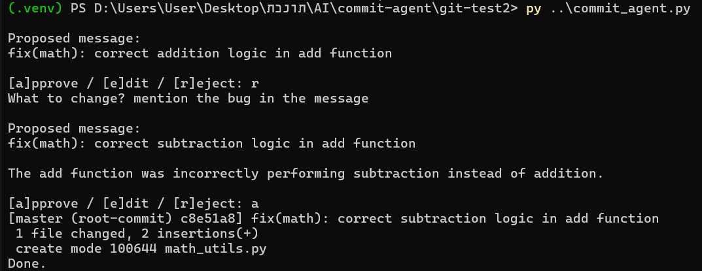
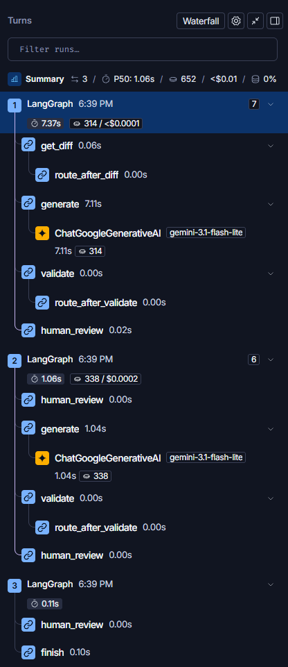
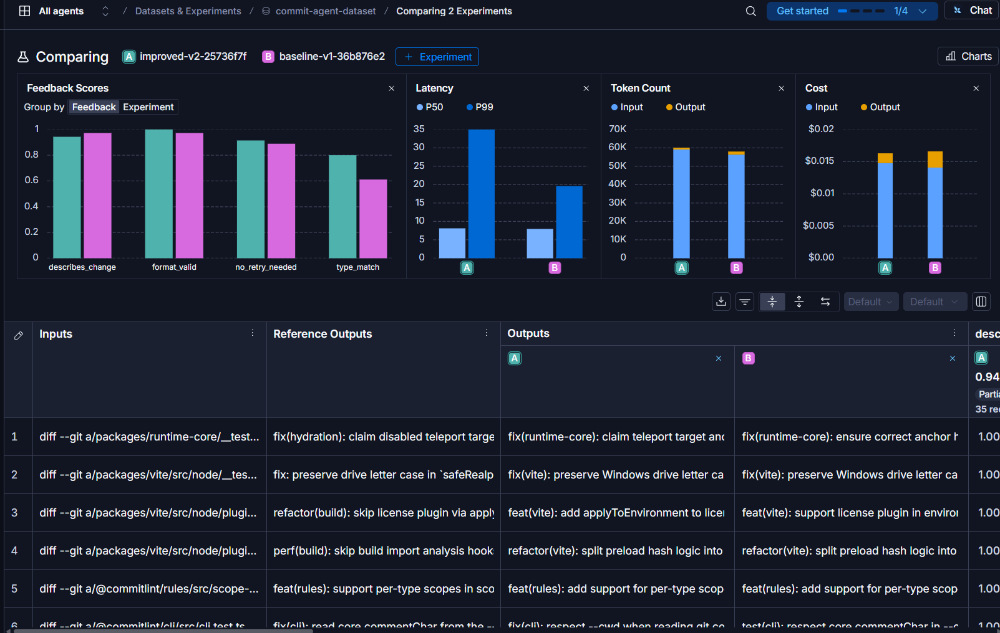
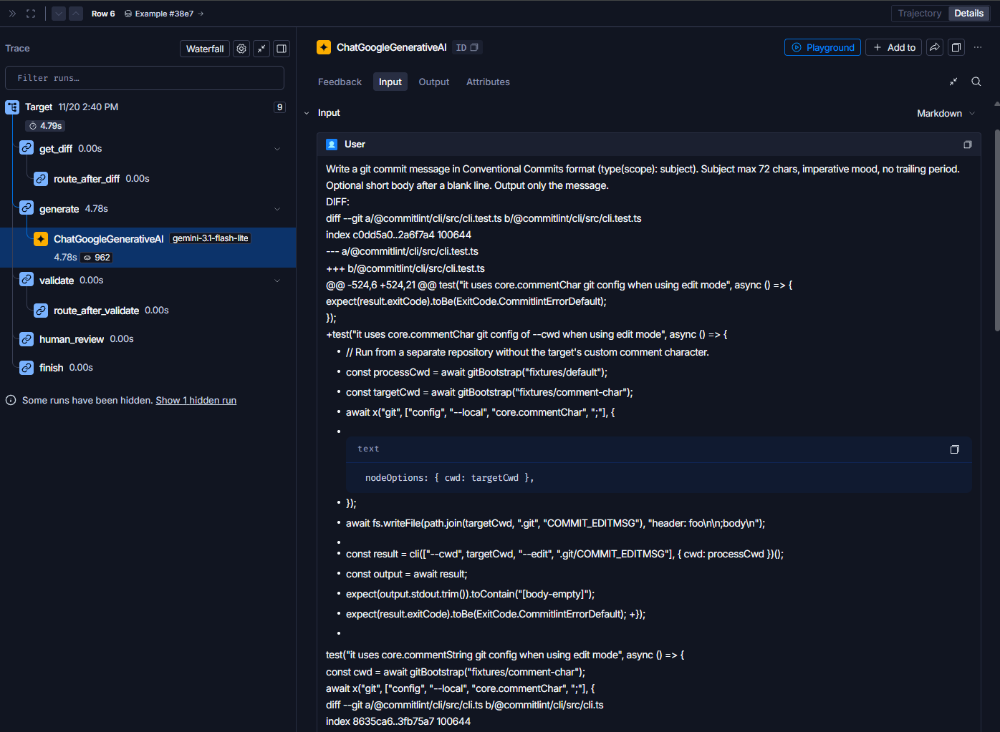
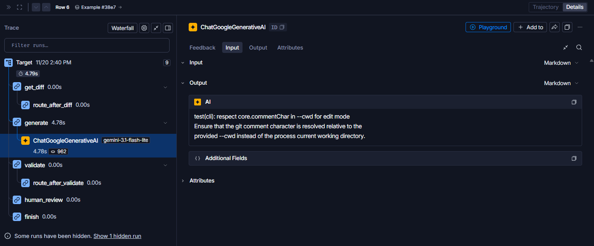
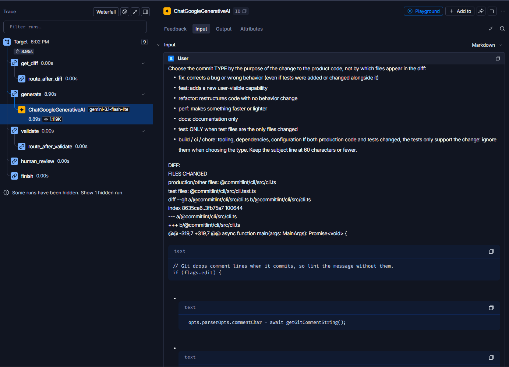
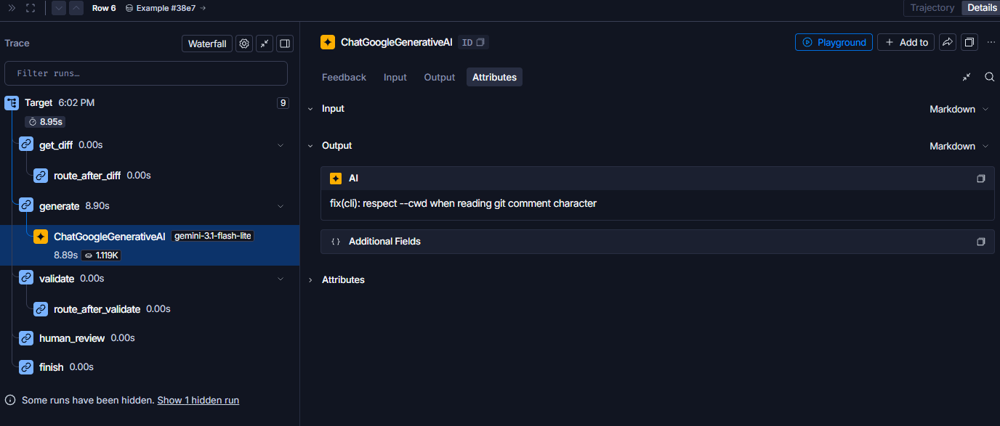

# סוכן הודעות Commit (LangGraph + LangSmith)

סוכן שקורא `git diff --staged` ומנסח הודעת commit בפורמט Conventional Commits (`feat:`, `fix:`, `docs:`...). לפני ה-commit האמיתי, המשתמשת מאשרת, עורכת או דוחה (עם הערה) את ההודעה.

## הגרף

```
get_diff ──(diff גדול)──→ summarize ──┐
    │                                  ↓
    └─────────────────────────────→ generate ←──────────────┐
                                       │                     │
                                   validate ──(נכשל, <3)─────┤
                                       │ (עבר)               │
                                  human_review (interrupt) ──┘ (דחייה + הערה)
                                       │ (אישור / עריכה)
                                     finish (git commit)
```

| דרישת התרגיל | איך מומשה |
|---|---|
| LangGraph | `StateGraph` עם State: `diff`, `draft`, `issues`, `attempts`, `feedback`, `final` |
| לולאה / ענף מותנה | `validate` (דטרמיניסטי, בלי LLM) בודק פורמט, אורך שורת נושא (עד 72) ונקודה בסוף. כישלון חוזר ל-`generate` עם רשימת הבעיות (עד 3 ניסיונות). ענף נוסף: diff גדול מ-12,000 תווים עובר קודם סיכום לפי קובץ (`summarize`) |
| interrupt / human-in-the-loop | `interrupt()` בצומת `human_review`: אישור, עריכה, או דחייה עם הערה שחוזרת ל-`generate`. דורש checkpointer (`MemorySaver`) |
| דאטהסט והערכה ב-LangSmith | ראו בהמשך |

## הרצה

```powershell
py -m venv .venv
.venv\Scripts\Activate.ps1
pip install langgraph langchain langsmith langchain-google-genai
$env:GOOGLE_API_KEY="..."
$env:COMMIT_MODEL="google_genai:gemini-3.1-flash-lite"
git add <קבצים>
py commit_agent.py
```

## human-in-the-loop: הדגמת ה-interrupt

ריצה אינטראקטיבית על קובץ עם באג (`return a - b` בפונקציית חיבור). הסוכן מציע הודעה ועוצר ב-`interrupt()`. דחיתי עם ההערה `mention the bug in the message`, הוא חזר ל-`generate` עם ההערה והציע הודעה חדשה שמזכירה את הבאג, ואישרתי. רק אז בוצע `git commit`.



ב-LangSmith כל המשך אחרי עצירה מופיע כ-turn נפרד על אותו thread (בזכות ה-checkpointer): turn 1 מסתיים בעצירה ב-`human_review`, turn 2 ממשיך מהדחייה דרך `generate` ו-`validate` ועוצר שוב, ו-turn 3 מאשר ומגיע ל-`finish`.



## הערכה ב-LangSmith

**דאטהסט** (`commit-agent-dataset`): 36 commit-ים אמיתיים (diff + ההודעה המקורית) מ-3 פרויקטי קוד פתוח שמשתמשים ב-Conventional Commits: `vitejs/vite`, `vuejs/core`, `conventional-changelog/commitlint`. נבחרו פרויקטים חיצוניים כי לפרויקטים שלי היו מעט מדי commit-ים, וברובם הודעות שלא בפורמט. סוננו commit-ים של merge, release, עדכוני תלויות, קבצי lock ו-diff-ים גדולים מ-8,000 תווים. הייצוא נעשה עם `export_dataset.py`.

**מעריכים** (`run_eval.py`; הגרף רץ במצב `auto` בלי interrupt ובלי commit אמיתי):

1. `format_valid` (קוד): ההודעה הסופית עוברת את בדיקות הפורמט.
2. `type_match` (קוד): הסוג (`feat`/`fix`/...) זהה לסוג של ההודעה המקורית.
3. `no_retry_needed` (קוד): הטיוטה הראשונה עברה את `validate` בלי לולאה.
4. `describes_change` (שופט LLM): ההודעה מתארת במדויק את מה שה-diff עושה.

### ניסוי לפני (`baseline-v1`) ואחרי (`improved-v2`)

| מעריך | לפני | אחרי |
|---|---|---|
| `type_match` | 0.61 (22/36) | **0.81 (29/36)** |
| `no_retry_needed` | 0.89 (32/36) | 0.92 (33/36) |
| `format_valid` | 0.97 (35/36) | 1.00 (36/36) |
| `describes_change` | 0.97 (35/36) | 0.94 (33/35)* |

\* בניסוי `improved-v2` שופט ה-LLM לא החזיר ציון לדוגמה אחת, ולכן הממוצע מחושב על 35 דוגמאות. ההפרש מול הבסיס הוא דוגמה אחת, כלומר בטווח הרעש.



## התובנה שהתגלתה מה-traces

בניסוי הבסיס **9 מתוך 14 טעויות הסוג היו `fix` שסווג כ-`test`** (למשל מקור `fix(cli): read core.commentChar from the --cwd repository in edit mode`, סוכן `test(cli): respect core.commentChar in --cwd for edit mode`). ב-trace של צומת `generate` רואים שהסיבה היא סדר הקבצים: git מציג את ה-diff לפי סדר אלפבית, ולכן קבצי בדיקות (`__tests__/`) מופיעים לפני קוד הייצור, ו-commit-ים של תיקון כוללים בדרך כלל גם בדיקה חדשה. המודל נעגן בבדיקות ובחר `test`, למרות שהתיאור שכתב נכון.

הקלט לצומת `generate` בבסיס: קובץ הבדיקות (`cli.test.ts`) מופיע ראשון, וקובץ הקוד (`cli.ts`) רק אחריו.



והפלט שהמודל החזיר:



**השיפור (v2)**, בהתאם לתובנה:
1. כללי בחירת סוג מפורשים בפרומפט (`test` רק כשהבדיקות הן הקבצים היחידים שהשתנו; כשהשתנו גם קוד וגם בדיקות, מתעלמים מהבדיקות).
2. סידור ה-diff מחדש: קבצי קוד לפני קבצי בדיקות, עם כותרת שמפרטת מהם.
3. יעד של שורת נושא עד 60 תווים (בבסיס דוגמה אחת נשארה ב-78 תווים גם אחרי 3 ניסיונות, כי המודל מתקשה לספור תווים).

התוצאה: טעויות `fix -> test` ירדו מ-9 ל-0.

אותה דוגמה ב-`improved-v2`: הכללים והכותרת `FILES CHANGED` בראש הפרומפט, וקובץ הקוד לפני קובץ הבדיקות.



הפלט אחרי השיפור (`fix(cli): respect --cwd when reading git comment character`):



## מגבלות

- **הטעויות שנשארו (7 מתוך 36)** הן בעיקר הבחנות סובייקטיביות: `perf` מול `refactor` מול `fix` מול `feat`. חלק מהן מקורן בהתייחסות עצמה (למשל `fix(deps): update compiler` או `test: fix flaky tests` שהסוכן סימן `fix`), כלומר לא בהכרח טעות של הסוכן.
- **ההתאמה לדאטהסט:** הכללים נכתבו אחרי שראיתי את הכשלים על אותן 36 דוגמאות, ולכן חלק מהשיפור עלול להיות התאמה יתר. לבדיקה אמיתית צריך דוגמאות חדשות.
- **שלושה שינויים יחד:** לא בודדתי איזה מבין השלושה תרם את רוב השיפור.
- **שופט ה-LLM** הוא אותו מודל שמייצר את ההודעות, ולכן עלול להיות מוטה לטובתו.
- **מגבלות קצב:** השכבה החינמית של Gemini (15 בקשות לדקה, 500 ליום) חייבה `max_concurrency=1` ומגביל קצב בקוד.

## קבצים

- `commit_agent.py` – הגרף וה-CLI (`PROMPT_VERSION=v2` מפעיל את הפרומפט המשופר)
- `export_dataset.py` – ייצוא diff-ים והודעות מ-git והעלאה ל-LangSmith
- `run_eval.py` – הרצת הערכה
- `show_failures.py` – סיכום הכשלים של ניסוי
